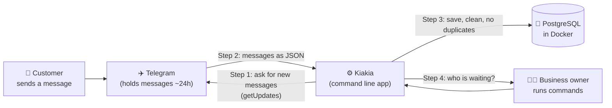
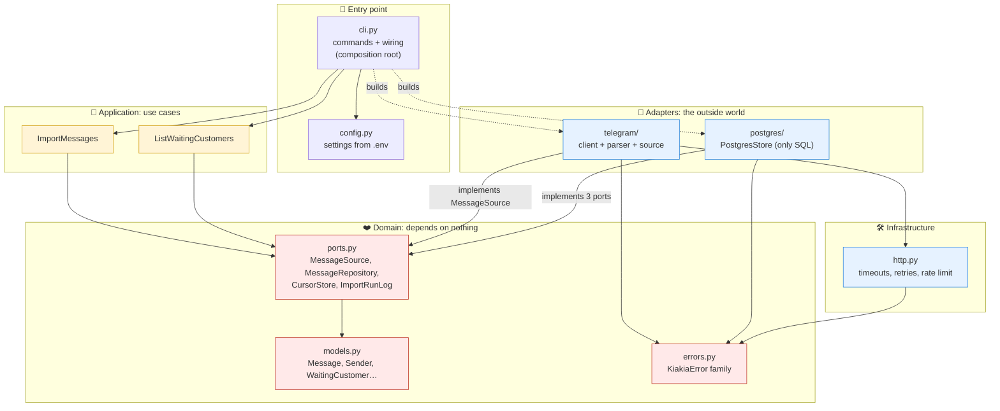
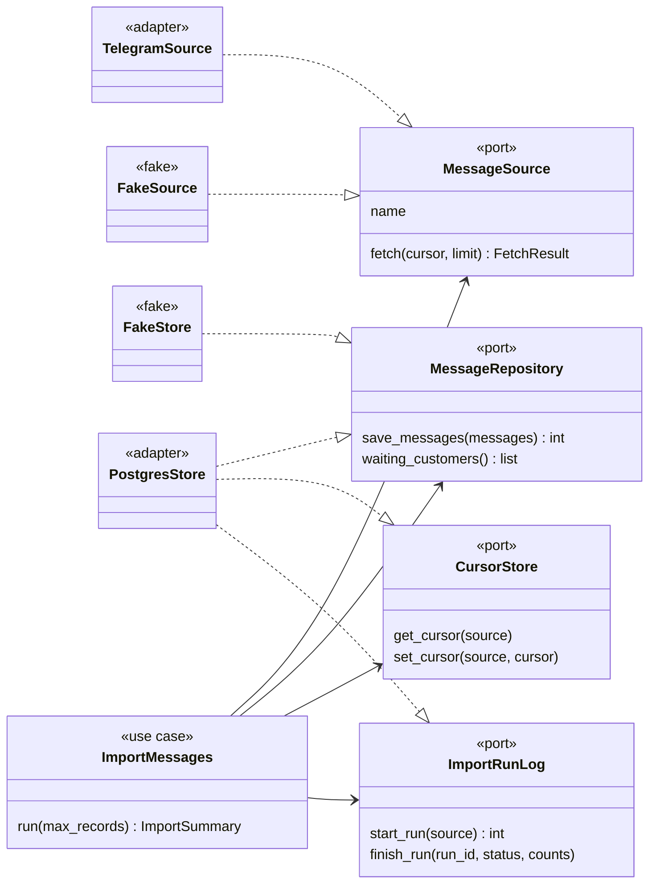
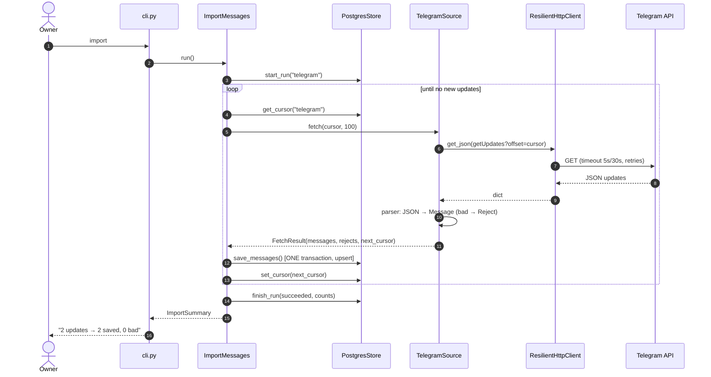
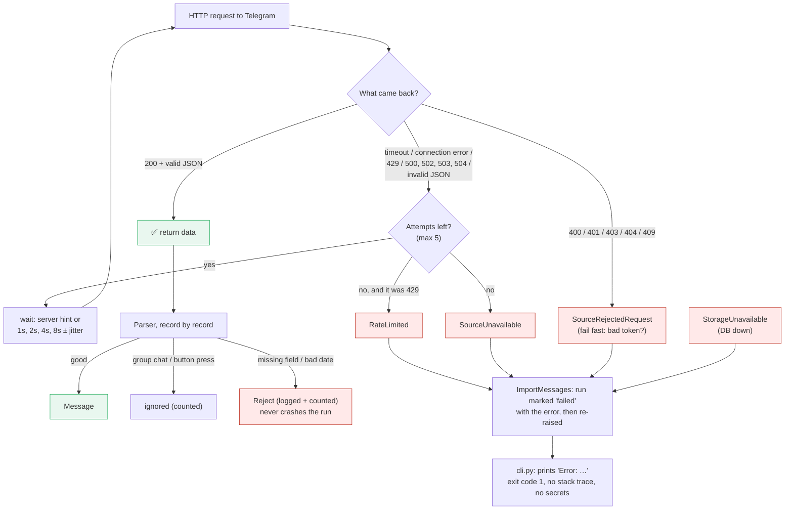
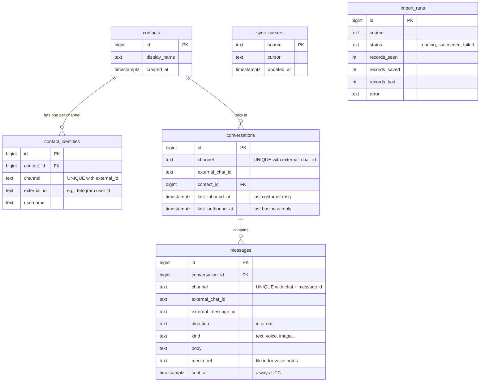
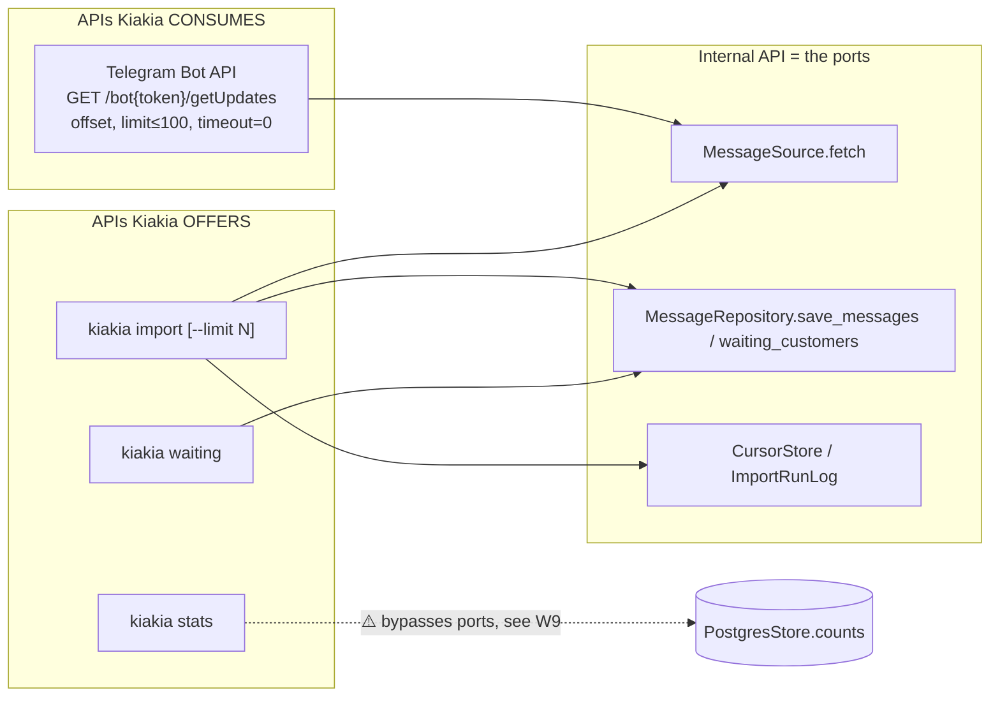
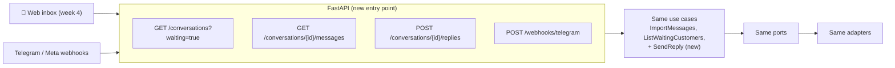

# Kiakia: Architecture Review

> A review of the code as it is on `main` (Week 1 + Python 3.12 modernisation).
> Part A explains how it works, in diagrams. Part B judges it against best practice
> and lists the weak parts, with evidence and fixes.
> GitHub draws the diagrams automatically.

---

# Part A: How Kiakia works

## A1. The big picture

What Kiakia does today, in one picture.

## A2. What kind of architecture is this?

**Clean Architecture, in the "Ports and Adapters" (Hexagonal) style.**

- The **domain** (Kiakia's own idea of a message, a customer, a waiting list) sits in the middle and
  depends on nothing.
- The **use cases** (import messages, list waiting customers) only talk to **ports**, which are interfaces.
- **Adapters** plug the real world in: Telegram on one side, PostgreSQL on the other.
- One place, `cli.py`, wires everything together: the **composition root**.

Patterns used: Repository, Adapter, Dependency Injection (constructor injection), Composition Root,
Use Case / Interactor, Anti-Corruption Layer (the parser), Strategy (the pluggable "retry-after" reader),
and Value Objects (frozen dataclasses).

## A3. Layers: who may talk to whom

Arrows mean "depends on / imports". **Every arrow points inwards**, which is the main rule of
Clean Architecture.

## A4. Ports and adapters (the "plugs")

The use cases only know the **interfaces** on the left. The real classes on the right fit into them.
Tests plug in fakes instead.

## A5. What happens when you run `import`

The most important flow. Note the order: **save first, move the cursor second.** Telegram deletes
messages once we ask for a later cursor, so this order means a crash can never lose a message.

## A6. Error handling: what happens when things go wrong

## A7. Database schema

Managed by **Alembic migration `0001`**. Unique keys (🔑) are what make imports idempotent.

`sync_cursors` and `import_runs` are bookkeeping tables, not linked to the others.

## A8. API design

Kiakia **doesn't expose an HTTP API yet**. Today it has two "API surfaces":

**Planned next (weeks 3–4):** a REST API (FastAPI) that reuses the **same use cases**, so nothing
underneath changes:

## A9. Coupling: how tightly parts are tied together

| From → To | Type of coupling | Verdict |
|---|---|---|
| Use cases → ports | **Interface coupling** (depends on a Protocol) | ✅ Best kind |
| Use cases → domain models | **Data coupling** (passes plain dataclasses) | ✅ Good |
| Parser → Telegram JSON | **Format coupling**, but *contained* in one file (anti-corruption layer) | ✅ Correct place for it |
| TelegramClient → ResilientHttpClient | **Concrete coupling** (a class, not an interface) | 🟡 Acceptable; could be a port later |
| Adapters → domain errors | **Inward dependency** | ✅ Correct direction |
| `cli.py` → everything | **Concrete coupling**, on purpose (composition root) | ✅ But it does two jobs (W8) |
| `cli stats` → `PostgresStore.counts()` | **Concrete coupling that bypasses ports** | 🔴 Leak (W9) |
| Alembic `env.py` → `kiakia.config` | Config coupling | ✅ Fine |
| Integration tests → migrations | Tests build the DB through Alembic | ✅ Excellent: tests prove migrations work |

---

# Part B: Review against best practice

## B1. What's already strong ✅

| Area | Why it's good |
|---|---|
| **Dependency rule** | The domain imports nothing from other layers; use cases only see ports. Checked file by file |
| **Idempotency** | DB unique keys + `ON CONFLICT DO UPDATE` + "save first, move cursor second" = no loss, no duplicates |
| **Resilience** | Timeouts, capped retries, exponential backoff with jitter, server hints, fail-fast on permanent errors |
| **Error translation** | `requests`/`psycopg` errors become Kiakia errors at the edge; the CLI shows clean messages |
| **Bad data** | The parser never crashes on one bad record; rejects are counted per run |
| **Schema versioning** | Alembic migrations; CI runs them up → down → up |
| **Testing** | 45 tests: unit (no network/DB, using fakes) + integration (real Postgres built by migrations) |
| **Tooling** | uv lockfile, ruff (incl. security rules), strict mypy, CI on every PR |
| **Secrets** | `.env` git-ignored; token never in logs or errors; `Settings.__repr__` hides it |
| **Time** | Aware datetimes enforced by the domain; stored in UTC, shown in Africa/Lagos time |

## B2. Weak parts 🔴

Each item says how I **proved** it, where it is, and how to fix it. Ordered by priority.

### 🔴 High priority

**W1. A database error can hide the real error.**
> ✅ **Fixed in Sprint 1:** the failure log is wrapped in its own try/except, and the original error is always re-raised. Test: `test_original_error_survives_when_logging_the_failure_also_fails`.
[kiakia/application/import_messages.py:70-79](../kiakia/application/import_messages.py)
If the database goes down while saving, the `except` block tries to write `finish_run(... "failed")`
to that same database, which fails too. The user then sees the *second* error and the real cause is lost.
*Proof:* with a fake DB that fails on both calls, the user saw `SECONDARY: could not log the run`.
*Fix:* wrap `finish_run` in its own try/except that logs and keeps the original error, so the
original is always what's re-raised.

**W2. A server can make Kiakia sleep for an hour.**
> ✅ **Fixed in Sprint 1:** a hint above `max_delay` raises `RateLimited(retry_after=…)` immediately instead of sleeping. Test: `test_huge_retry_after_is_not_obeyed_blindly`.
[kiakia/infrastructure/http.py:110](../kiakia/infrastructure/http.py)
The server's "retry after" hint is used as-is. `RetryPolicy.max_delay = 30` doesn't apply to it.
*Proof:* a `Retry-After: 3600` response made the client sleep 3600 seconds.
*Fix:* `delay = min(wait_hint, self.retry.max_delay)`. If the hint is bigger than allowed, raise
`RateLimited(retry_after=hint)` instead of blocking.

**W3. The database is reachable from your whole network.**
> ✅ **Fixed in Sprint 1:** Compose publishes `127.0.0.1:55432` only; the local container was recreated the same way, with the same data.
[docker-compose.yml:10](../docker-compose.yml)
`"55432:5432"` binds to `0.0.0.0`, so anyone on the same Wi-Fi (café, office) can try to log in.
*Proof:* `docker port kiakia-db` shows `0.0.0.0:55432`.
*Fix:* `"127.0.0.1:${POSTGRES_PORT:-55432}:5432"`, so only your own laptop can connect.

**W4. Messages are lost if the import isn't run within ~24 hours.**
This is how Telegram's `getUpdates` works, not a bug, but today nothing runs the import automatically.
*Fix (short term):* a scheduled job (cron/launchd) every few minutes.
*Fix (proper, week 3):* **webhooks**, where Telegram pushes each message to us instantly. That's also
needed for the real-time "customer waiting" alerts.

**W5. Rejected records are gone for good.**
[kiakia/application/import_messages.py:65-66](../kiakia/application/import_messages.py)
A bad update is only *logged*, then the cursor moves past it and Telegram deletes it, so it can never be
inspected or replayed.
*Fix:* a **dead-letter table** (`rejected_updates`: source, ref, reason, raw JSON, received_at), written in
the same transaction as the good messages.

### 🟡 Medium priority

**W6. A password with special characters breaks migrations.**
> ✅ **Fixed in Sprint 1:** the URL is built with `sqlalchemy.URL.create`. Test: `test_password_with_special_characters_survives_the_url`.
[kiakia/config.py:28-33](../kiakia/config.py)
The DB URL is built by gluing strings together, so `@` or `/` in the password corrupts it.
*Proof:* with password `p@ss/word`, the URL parser read the host as `ss` and the password as `p`.
*Fix:* build it with `sqlalchemy.URL.create(...)`, which escapes every part safely.

**W7. A wrong setting shows a raw Python crash.**
> ✅ **Fixed in Sprint 1:** settings are validated by **pydantic-settings**; all problems are reported at once, without echoing values, and secrets are `SecretStr`. 9 tests in `tests/unit/test_config.py`.
[kiakia/config.py:60](../kiakia/config.py)
`int(os.getenv("POSTGRES_PORT"))` throws a plain `ValueError` that skips the friendly `ConfigError` path.
*Proof:* `POSTGRES_PORT=abc` printed `ValueError: invalid literal for int()` with a stack trace.
*Fix:* validate all settings in one place. Best practice is **pydantic-settings**, which validates types and
reports every bad setting at once with a clear message.

**W8. `cli.py` does two jobs.**
[kiakia/cli.py](../kiakia/cli.py)
It's both the **user interface** (printing) and the **composition root** (building objects). When the
FastAPI entry point arrives, the wiring would get copied, which is duplication.
*Fix:* move wiring to `kiakia/bootstrap.py` (e.g. `build_import_use_case(settings)`), used by both
the CLI and the future API.

**W9. `stats` bypasses the ports.**
[kiakia/cli.py:73-77](../kiakia/cli.py), [kiakia/adapters/postgres/repository.py:198](../kiakia/adapters/postgres/repository.py)
`counts()` isn't on any port, so the CLI depends directly on `PostgresStore`, a small crack in the
architecture.
*Fix:* add a `GetStats` use case and a small `StatsQuery` port.

**W10. Database connections are never closed.**
[kiakia/cli.py:27-30](../kiakia/cli.py)
Fine for a short command, but a long-running web API would leak connections.
*Fix:* use `with connect(...) as conn:` in the composition root now, and a **connection pool**
(`psycopg_pool`) for the API later.

**W11. Two imports at the same time can crash each other.**
[kiakia/adapters/postgres/repository.py:85](../kiakia/adapters/postgres/repository.py)
`_contact_id` does "look up, then insert if missing". If two runs see a new customer simultaneously, both
insert and one fails on the unique key. Nothing stops two runs at once (e.g. a scheduled job + you by hand).
*Found by reasoning, not yet proven with a test.*
*Fix:* take a Postgres **advisory lock** per source at the start of `ImportMessages.run`, and make
`_contact_id` a single `INSERT … ON CONFLICT … RETURNING`.

**W12. Messages and cursor are saved in two separate transactions.**
[kiakia/application/import_messages.py:68-69](../kiakia/application/import_messages.py)
This is safe today thanks to idempotency (at-least-once), but it relies on every future repository being
idempotent too.
*Fix (cleaner):* a **Unit of Work** port, so the use case can say "save these messages *and* this cursor
together". That gives exactly-once delivery inside the DB.

### 🟢 Low priority / polish

| # | Weakness | Where | Fix |
|---|---|---|---|
| W13 | Run status is a free string (`"failed"`) | `ports.py`, `import_messages.py` | `RunStatus` StrEnum (avoid "stringly typed" code) |
| W14 ✅ | ~~`update_id: true` (a boolean) is accepted as `1`~~ **Fixed** with a `TypeGuard` helper `_is_int` | [parser.py:122](../kiakia/adapters/telegram/parser.py) | `type(update_id) is int` |
| W15 | `channel` column has no CHECK, while `direction` and `kind` do | migration 0001 | Add it in migration `0002` |
| W16 | Foreign keys without indexes (`contact_identities.contact_id`, `conversations.contact_id`) | migration 0001 | Indexes in `0002` |
| W17 | 4–6 SQL statements per message (N+1 pattern) | `repository.py:76` | Batch with `executemany` when volumes grow |
| W18 | Plain-text logs, no metrics | everywhere | Structured JSON logs + counters (later: OpenTelemetry) |
| W19 | No tests for `TelegramSource` or `cli.py` (config tests ✅ added in Sprint 1) | `tests/` | Add them; measure coverage with `pytest-cov` |
| W20 | Sync `requests`, while FastAPI is async | `http.py` | Consider `httpx` when the API arrives |

## B3. Security review 🔐

| Check | Status | Notes |
|---|---|---|
| Secrets out of git | ✅ | `.env` ignored; CI uses a throwaway password |
| Token never logged | ✅ | URL never in logs/errors; urllib3 debug muted; `__repr__` masked |
| SQL injection | ✅ | Parameterised SQL only; ruff's bandit rules (`S`) enforce it |
| Input validation | ✅ | Parser treats all API data as untrusted |
| DB exposed to the network | 🔴 | W3: bind to 127.0.0.1 |
| Least privilege | 🟡 | The app uses the Postgres **superuser**. Create a `kiakia_app` role with only SELECT/INSERT/UPDATE, and keep the owner role for migrations |
| Personal data (NDPR/NDPA, GDPR) | 🟡 | Message text is stored unencrypted, with no retention policy. Add a retention job ("delete messages older than N months") and a "delete this customer" use case |
| Dependency vulnerabilities | 🟡 | Add **Dependabot** (or `pip-audit` in CI) to get alerts for vulnerable packages |
| CI supply chain | 🟡 | GitHub Actions use version tags (`@v4`); best practice is pinning to a commit SHA |
| Dead-lettered raw JSON (W5) | ⚠️ | When added, it contains customer data, so give it the same retention rules |

## B4. Recommended order of improvements

```mermaid
flowchart LR
    subgraph S1["✅ Sprint 1: quick safety fixes (DONE)"]
        A1["W3 bind DB to localhost"]
        A2["W2 cap retry-after"]
        A3["W1 keep the original error"]
        A4["W6/W7 safe config<br/>(pydantic-settings)"]
        A5["W14 strict update_id"]
    end
    subgraph S2["Sprint 2: architecture polish (1 day)"]
        B1["W8 bootstrap.py"]
        B2["W9 GetStats use case"]
        B3["W10 close connections"]
        B4["W13 RunStatus enum"]
        B5["Migration 0002:<br/>W15 + W16 + dead-letter table (W5)"]
    end
    subgraph S3["Sprint 3: production readiness"]
        C1["W11 advisory lock"]
        C2["W12 Unit of Work"]
        C3["W4 webhooks (week 3)"]
        C4["Least-privilege DB role"]
        C5["Dependabot + coverage"]
    end
    S1 --> S2 --> S3
```

**Bottom line:** the architecture is **sound and follows Clean Architecture correctly**. The
dependency rule is respected, the use cases are fully decoupled, and the reliability design (idempotency,
save-then-confirm) is right. The weak parts are mostly **edges**: error masking, uncapped waits, config
validation, a network-exposed database, and lost rejects. All are fixable without changing the architecture.
