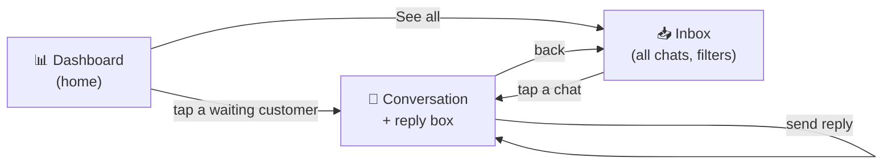

# Kiakia: UI/UX Design

> Design for the Kiakia web inbox (Assignment 2). It's built **only** from
> [openapi.yaml](../../openapi.yaml): every screen element below names the contract field it
> uses. If the UI ever needs something the contract doesn't have, the contract changes first,
> with an ADR (rule from [ADR 0001](../adr/0001-contract-first-openapi.md)).
>
> 👉 Try the clickable mockup: [mockup.html](mockup.html) (open it in a browser; it uses fake data).
>
> **Revision 2 (owner feedback):** platform icons with unique colours everywhere, filters for
> date/time, platform and category, clearer "received … ago, no reply yet" wording, a light/dark
> switch, a richer dashboard (response rate, typical reply time, a per-platform drill-down), and
> marking chats **resolved** with a category (enquiry / order / complaint / other). The new API needs
> are in [ADR 0006](../adr/0006-dashboard-filters-resolve-categories.md) (contract first).

---

## 1. Who uses it, and what they need in 5 seconds

| Person | Situation | What they need first |
|---|---|---|
| **The owner** (me) | Busy, often away, checks on the phone between tasks | "**Is anyone waiting? Who has waited longest?**" |
| **The sales rep** | At the shop, replying all day, on a laptop or phone | A queue to work through, oldest first, and a fast reply box |

**Design promise:** in **5 seconds** the owner knows if a customer is waiting and for how long.
In **2 taps** the rep is replying to the longest-waiting customer.

## 2. Design principles

1. **Urgency first.** Waiting time is the most important number on every screen, colour-coded:
   🟢 < 5 min · 🟠 5–15 min · 🔴 > 15 min (15 min = the "missed" limit in PLAN.md).
2. **Phone first.** Designed for a 375 px wide screen, then expanded for laptops.
3. **Feels like a chat app.** Bubbles, a reply box at the bottom: no training needed.
4. **Never leave people guessing.** Every loading, empty, error and "sending" state is designed,
   not left to chance.
5. **Safe by default.** A reply can't be sent twice (idempotency); unclear deliveries say so honestly.
6. **Accessible.** Colour is never the only signal (icons + text too); good contrast; keyboard-friendly.

## 3. Screens



### 3.1 Dashboard (home): "Who's waiting?"

```
┌──────────────────────────────────────────────┐
│ Kiakia ⚡             ● Live · updated 5s ago │
├──────────────────────────────────────────────┤
│ ┌─────────┐ ┌─────────┐ ┌────────┐ ┌───────┐ │
│ │ 3       │ │ 1h 05m  │ │ 12     │ │ 48    │ │
│ │ waiting │ │ longest │ │ chats  │ │ msgs  │ │
│ └─────────┘ └─────────┘ └────────┘ └───────┘ │
│                                              │
│ ⏳ Waiting for a reply (longest first)        │
│ 🔴 Ada Test     "Do you have it in red?" 1h05│
│ 🟠 Chidi        🎤 Voice note           12m  │
│ 🟢 100% Real    "price?"                 2m  │
│                                   See all →  │
│ Messages by kind: ▇▇▇▇▇ text 40 ▇ voice 8    │
└──────────────────────────────────────────────┘
```

| Element | Contract source |
|---|---|
| "3 waiting" | `GET /v1/stats` → `waiting` |
| "1h 05m longest" (live timer) | `stats.oldestWaitingSince` (`null` → "Nobody waiting 🎉") |
| "12 chats", "48 msgs" | `stats.conversations`, `stats.messages` |
| Messages by kind (bar) | `stats.messagesByKind` |
| Waiting list | `GET /v1/conversations?status=waiting&sort=longestWaiting&limit=5` |
| Name, preview, timer, heat colour | `contact.displayName`, `lastMessagePreview`, `waitingSince` |
| Badge "2 new" | `unansweredCount` |

### 3.2 Inbox: all conversations

```
┌──────────────────────────────────────────────┐
│ [ All ] [ Waiting 3 ] [ Answered ]           │
│ 🔍 Search name or @username   Channel: [All▾]│
├──────────────────────────────────────────────┤
│ 🔴 Ada Test  @ada_test        2 new   1h 05m │
│    "Do you have it in red?"          ✈️ tg   │
│ ✅ Bayo      "Are you open today?"    answered│
│ …                                            │
│              [ Load more ]                   │
└──────────────────────────────────────────────┘
```

| Element | Contract source |
|---|---|
| Tabs | `status=all|waiting|answered` |
| Search | `q` (1–100 chars, debounced 300 ms) |
| Channel filter | `channel` (enum `Channel`) |
| Sort | `sort=recent` (All/Answered) or `longestWaiting` (Waiting tab) |
| "Load more" | `page.nextCursor` → `cursor` (button hidden when `null`) |
| Username shown only if present | `contact.username` is **nullable** |

### 3.3 Conversation + reply

```
┌──────────────────────────────────────────────┐
│ ← Ada Test  @ada_test · Telegram   ⏳ 1h 05m  │
├──────────────────────────────────────────────┤
│  ┌───────────────────────────┐               │
│  │ Hello, how much is the     │ 09:00        │
│  │ blue bag?                  │              │
│  └───────────────────────────┘               │
│  ┌───────────────────────────┐               │
│  │ 🎤 Voice note              │ 09:05        │
│  └───────────────────────────┘               │
│               ┌───────────────────────────┐  │
│        09:12  │ It's ₦15,000! ✓ Sent      │  │
│               └───────────────────────────┘  │
├──────────────────────────────────────────────┤
│ [ Type a reply…                          ]   │
│  ⚠ must not be empty or only spaces  12/4096 │
│                                   [ Send ➤ ] │
└──────────────────────────────────────────────┘
```

| Element | Contract source |
|---|---|
| Header | `GET /v1/conversations/{id}` → `contact`, `channel`, `status`, `waitingSince` |
| Bubbles (left = customer, right = us) | `GET …/messages` → `direction` (`in`/`out`), `body`, `sentAt` |
| 🎤 / 📷 placeholder when no text | `kind` + `hasMedia`, with `body` **null** |
| "Load older messages" | `page.nextCursor` (newest first) |
| Reply box | `POST …/replies` with `{ "text" }` and an `Idempotency-Key` header |
| Field error under the box | Problem Details `errors[].field == "text"` → `message` |

## 4. Every state is designed

| State | What the user sees | Trigger |
|---|---|---|
| **Loading** | Grey "skeleton" rows that shimmer (no layout jump) | Request in flight (first load) |
| **Empty: nobody waiting** | "🎉 Nobody is waiting. Every customer has a reply." | `waiting = 0` / empty `data` |
| **Empty: search** | "No chats match "xyz". Clear the search." | Empty `data` with `q` set |
| **Error: API down** | Red banner "Can't reach Kiakia. Retrying in 10s…" + **Retry** button; the last data stays visible | Network error, 503, 500 |
| **Validation error** (reply) | Red text **under the box**, using the API's own `errors[].message`; the draft is kept | 422 |
| **Sending** | Button shows "Sending…", the box is locked, and the bubble appears faded | POST in flight |
| **Sent** | Bubble ✓ Sent; the customer leaves the waiting list | 201 |
| **Retried safely** | Same bubble, toast "Already sent, not sent twice ✓" | 201 + `Idempotent-Replayed: true` |
| **Channel refused** | "Telegram refused: bot was blocked by the user." The draft is kept | 502 `channel-error` |
| **Delivery unknown** | ⚠ "We couldn't confirm it was delivered. Check the chat before sending again." | 502 `delivery-unknown` |
| **Conflict** | "This reply is still being processed. Refresh in a moment." | 409 |
| **Not found** | "This conversation doesn't exist (anymore)." + back to Inbox | 404 |
| **No match for filters** | "No chats match these filters." + **Clear all filters** button | Empty `data` with filters set |

## 5. Interactions ("make it interactive" challenge)

- **Live timers:** waiting times tick every second, and the heat colour changes as time passes (🟢 → 🟠 → 🔴).
- **Auto-refresh:** lists and stats refresh every **10 s** (polling), with a "● Live · updated 5s ago"
  indicator. It pauses when the tab is hidden, to save battery and data.
- **Optimistic reply:** the bubble appears instantly as "sending", then becomes ✓ or shows the error.
- **Idempotency in the UI:** each **draft** gets one `Idempotency-Key` (`crypto.randomUUID()`), kept
  until the reply succeeds. A retry after a network error reuses it, so it's never sent twice.
  A new reply gets a new key.
- **Keyboard:** `Enter` sends, `Shift+Enter` adds a new line, `/` focuses search, `Esc` goes back.
- **Celebration:** when the last waiting customer is answered, a small 🎉 animation plays.

## 6. Visual language

| Token | Light | Dark | Use |
|---|---|---|---|
| Brand | `#0F7B5F` (deep green) | `#34D399` | Logo, primary buttons, "our" bubbles |
| Accent | `#F59E0B` (amber) | `#FBBF24` | Highlights, the ⚡ in the logo |
| Heat green / amber / red | `#16A34A` / `#D97706` / `#DC2626` | lighter versions | Waiting timers (always with an icon too) |
| Surface / text | `#FFFFFF` / `#111827` | `#0B1220` / `#E5E7EB` | Background / text |

- **Font:** the system font (`-apple-system, Segoe UI, Roboto…`): fast to load, and familiar on every phone.
- **Shapes:** rounded cards (12 px), chat bubbles (16 px), plenty of spacing for thumbs (44 px tap targets).
- **Dark mode** follows the phone's setting.

## 7. Responsive layout

| Width | Layout |
|---|---|
| Phone (< 768 px) | One screen at a time: Dashboard → Inbox → Conversation; bottom navigation |
| Laptop (≥ 1024 px) | Top navigation (Dashboard · Inbox · Messages by platform); the Inbox has **two panes**: chat list on the left, conversation on the right |
| Phone navigation | The three views move to a **bottom bar**, within thumb reach |

## 8. Revision 2: what changed and where the data comes from

### 8.1 Platforms: icons + unique colours (UI only)
Every chat row, chat header and **every message bubble** shows its platform icon in a coloured circle,
and platform names appear as coloured "pills". The icons are simple shapes drawn for Kiakia (not the
official logos), always with the name as a tooltip / screen-reader label.

| Platform | Colour | Icon |
|---|---|---|
| Telegram | `#229ED9` sky blue | paper plane |
| WhatsApp | `#25D366` green | phone in a bubble |
| Instagram | `#E1306C` pink | rounded camera |
| Messenger | `#8B5CF6` violet | bubble with a zig-zag |
| TikTok | black (white in dark mode) | music note |
| Email | `#64748B` slate | envelope |

### 8.2 Clearer time wording (UI only)
"12 min" alone was ambiguous. Now:
- List: **"📩 Received 12 min ago · no reply yet"** (coloured 🟢/🟠/🔴), **"↩ You replied 44 min ago"**,
  or **"✓ Resolved yesterday"**.
- Chat header: **"Waiting 12 min for a reply: the first unanswered message arrived today 10:42."**
- Dashboard: **"Longest wait: Ada Test, since today 09:12"**.

### 8.3 Light / dark switch (UI only)
A header button cycles **🌗 Auto → ☀️ Light → 🌙 Dark**, remembered on the device. Auto follows the phone.

### 8.3b "Customers waiting" is a traffic light (UI only)
The most important card on the dashboard changes its **whole colour**, so it can be read from across the shop:

| Situation | Card | Text | Icon |
|---|---|---|---|
| Anyone waiting | **Solid red** `#DC2626`, gently pulsing | "5 customers waiting for a reply right now · tap to answer" | 🚨 |
| Nobody waiting | **Solid green** `#15803D` | "nobody waiting · all caught up 🎉" | ✅ |

- The same strong red and green are used in light **and** dark mode, so white text always has good
  contrast (WCAG AA).
- The colour is never the only signal: the icon and the words change too (colour-blind friendly).
- The pulse stops for people who turn on "reduce motion" on their phone.
- Tapping the card opens the Inbox on the Waiting tab. Data: `stats.waiting`.

### 8.4 Filters (contract: ADR 0006 §1)
Inbox filters: **status tabs** (Waiting / Answered / Resolved / All), **platform toggles** (tap the icons),
**date** (Any time, Today, Yesterday, Last 7 days, Last 30 days, Custom range), **category**, and search.
→ `GET /v1/conversations?status=&channel=&from=&to=&category=&q=`

> **Built version note:** the contract's `channel` filter takes **one** platform at a time, so the real
> app's platform filter is "All" or one platform (tap an icon). Several at once would need a contract
> change and an ADR first; it wasn't needed for the assignment.

### 8.5 Better dashboard (contract: ADR 0006 §2–3)
| Card | Contract source |
|---|---|
| Customers waiting right now | `stats.waiting` |
| Longest wait (name + time) | first item of `status=waiting&sort=longestWaiting` |
| **Response rate** (ring) | `stats.responseRate` |
| **Typical time to first reply** | `stats.medianFirstResponseSeconds` |
| **Messages received → by platform** (clickable) | `stats.byChannel[]` → opens the *Messages by platform* view |
| Messages by platform (bars) | `stats.byChannel[].messages` |
| What customers write about | `stats.byCategory` |
| Period switch (Today / 7 / 30 days / All) | `GET /v1/stats?from=&to=` |

**Messages by platform view:** one card per platform (messages, chats, waiting, % answered) and a list
of all messages, newest first, filterable by platform and period → `GET /v1/messages?channel=&from=&to=`.
Clicking a message opens its conversation.

### 8.6 Resolve + categorise (contract: ADR 0006 §4)
In the chat header: a **category** menu (❓ Enquiry, 🛍️ Order, ⚠️ Complaint, 💬 Other) and
**✓ Mark resolved / ↺ Reopen** → `PATCH /v1/conversations/{id}`.
A resolved chat leaves the waiting list; **if the customer writes again, it automatically returns to
Waiting**, so resolving can never hide a new question.

## 9. Tech (from ADR 0005)

React + Vite + TypeScript in `web/`. API types are generated from `openapi.yaml`
(`openapi-typescript`), so the UI can't use a field the contract doesn't define.
The Vite dev server proxies `/v1` to the API at `localhost:8000`, so no CORS is needed locally.
